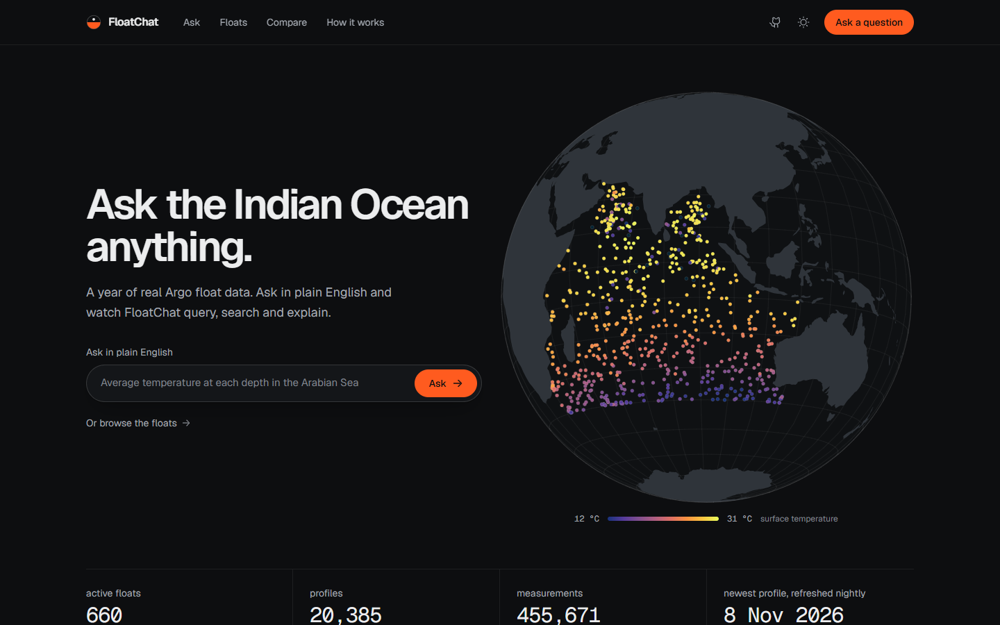
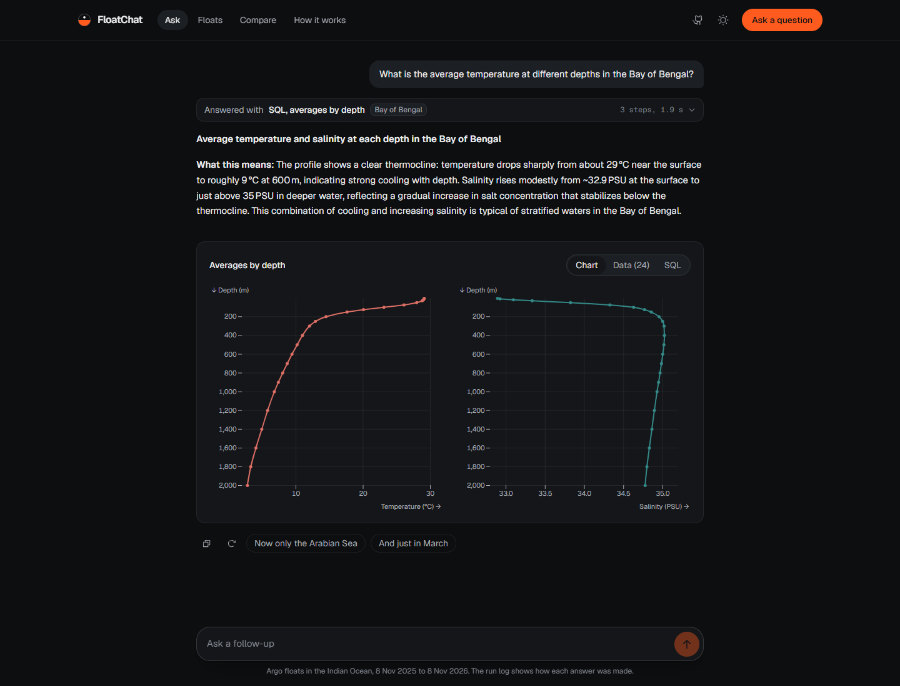
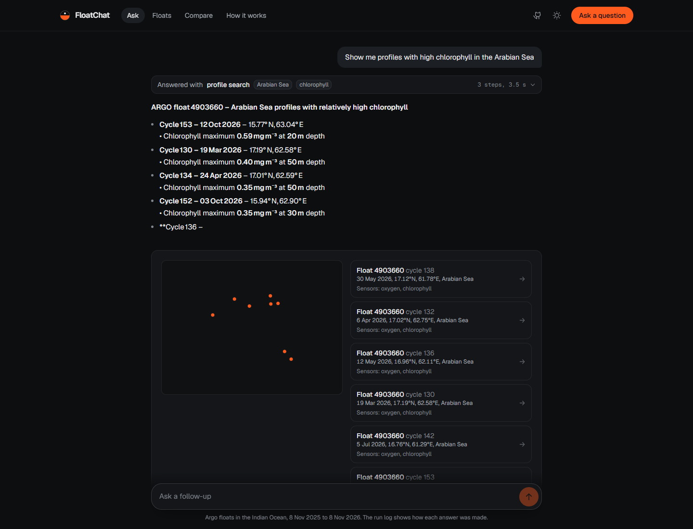
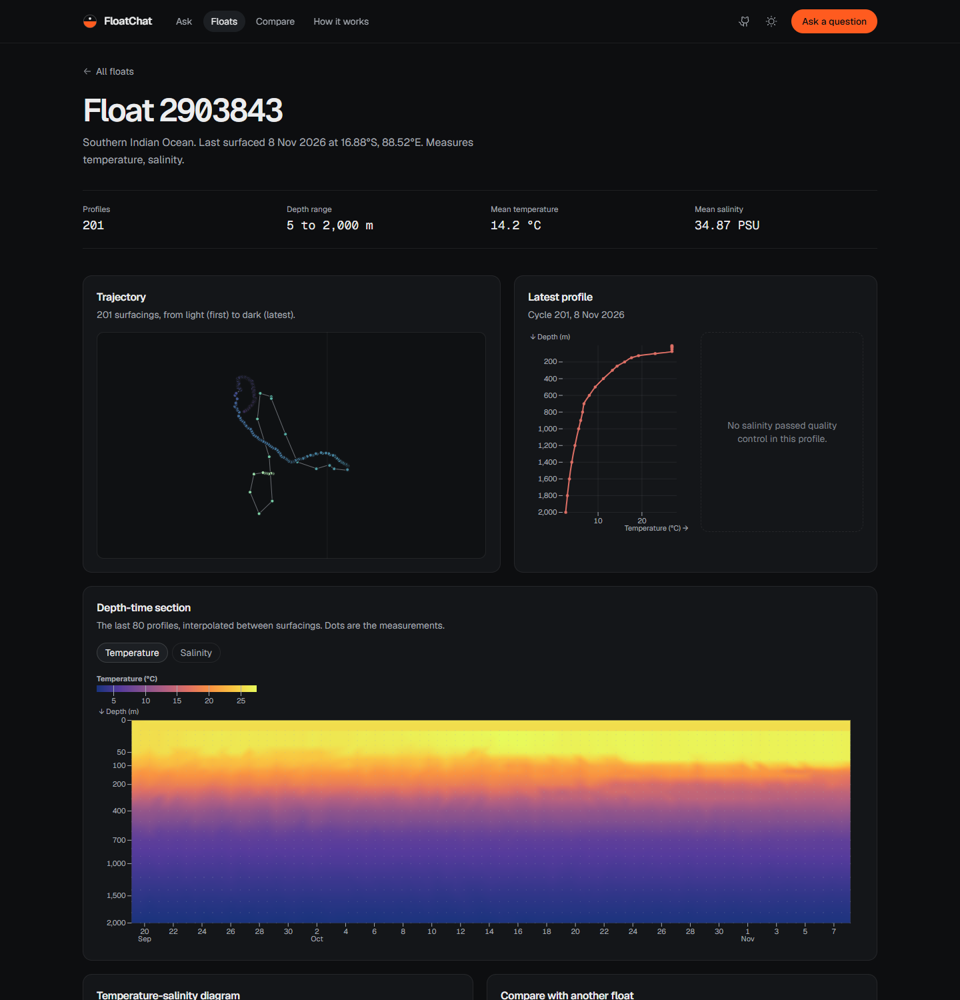

# 🌊 FloatChat: talk to the ocean

**Ask questions about a year of real ocean data in plain English. FloatChat writes the SQL or searches the
profiles, shows every step it took, and draws the charts.**

### ▶ Try it live: [float-chat-ai-teal.vercel.app](https://float-chat-ai-teal.vercel.app)

[](https://float-chat-ai-teal.vercel.app)

**Live API:** [floatchat-ai-svjw.onrender.com/docs](https://floatchat-ai-svjw.onrender.com/docs) ·
**Benchmark:** 30/30 questions fully correct ([details](eval/latest.md)) · **Deploy your own:** [DEPLOY.md](DEPLOY.md)

**Contents:** [What FloatChat is](#-what-floatchat-is) · [How it's built](#-how-its-built) ·
[How well it works](#-how-well-it-works) · [Run it on your machine](#-run-it-on-your-machine) ·
[Using it](#-using-floatchat) ·
[Limitations & roadmap](#-limitations--roadmap)

---

## 🌍 What FloatChat is

### The ocean has sensors everywhere, and almost nobody can use the data

[Argo](https://argo.ucsd.edu) is an international program that keeps about **4,000 robotic floats** drifting in
the world's oceans. Each float parks about 1,000 m deep. Every ~10 days it dives to 2,000 m, then rises to the
surface measuring **temperature, salinity** and, on biogeochemical (BGC) floats, **dissolved oxygen** and other
chemistry. At the surface it sends this **profile** home by satellite. Argo data feed climate research, monsoon and
cyclone forecasting, fisheries and ocean models, and the data are free for anyone to use.

The catch is that using the data takes specialist skills. It comes as NetCDF files from data servers, organised by
float and cycle, with quality flags and pressure coordinates. To answer something simple, like *"how much colder is
the Bay of Bengal at 500 m than at the surface?"* or *"where is the oxygen minimum zone in the Arabian Sea?"*, you
need to know which files to download, how to read them, and how to write the analysis code.

### Why we're building FloatChat

FloatChat removes that barrier. You type a question as you'd ask a colleague, and FloatChat:

1. works out what kind of question it is,
2. finds the right data, either by **writing SQL** for statistical questions or by **searching** thousands of
   profiles for descriptive ones,
3. answers in words, optionally explained by a large language model (LLM), and
4. draws the **maps, depth profiles and charts** that go with the answer, with the data ready to download.

It's built for students, researchers, educators and curious people who want to explore the ocean without first
becoming data engineers.

### What happens when you ask a question

| You ask… | FloatChat… |
|---|---|
| *"What is the average temperature at different depths in the Bay of Bengal?"* | the router sees a statistical question about one region → runs the depth-average SQL with a region filter → explains the pattern, with the chart, the data and the SQL |
| *"now only the Arabian Sea"* | understands a follow-up → keeps the analysis, swaps the region |
| *"Show me salinity profiles near the equator in March 2026"* | sees a descriptive question → reads "equator", "March" and "2026" as filters → searches its vector index of profile descriptions → shows the matching profiles on a map |
| *"How many profiles were recorded in the Arabian Sea?"* | no template fits → the LLM writes SQL, checked as read-only, and repaired from the database error if it fails |

Every answer opens with a **run log**: what was understood, each SQL attempt with its rows and timing, the search,
and who wrote the text, so every number can be checked against the query that produced it.

| Statistical question → SQL, chart and data | Descriptive question → search and map |
|---|---|
|  |  |

Each float has its own page: trajectory, latest profile, a depth-time section and a temperature-salinity diagram.



### The data in this demo

All data are **real Argo observations** from the **Indian Ocean**, downloaded from the
[Ifremer ERDDAP](https://erddap.ifremer.fr/erddap/) server, keeping only values that passed Argo's quality control:

| | [Live demo](https://float-chat-ai-teal.vercel.app) | Bundled snapshot (local setup) |
|---|---|---|
| Period | rolling last 12 months, refreshed nightly | January to March 2024 |
| Floats | about 660 (107 measuring oxygen) | 437 (52 measuring oxygen) |
| Profiles | about 20,000 | 3,898 |
| Measurements | about 455,000 | 88,361 |

BGC floats also measure chlorophyll, nitrate and pH; the oxygen data shows the Arabian Sea's oxygen minimum zone
clearly. Each profile is labelled with a region: Arabian Sea, Bay of Bengal, Equatorial, Southern and Eastern Indian
Ocean, Red Sea & Gulf of Aden. You can download a different period or ocean region with one command (see
[Using other data](#using-other-data)).

---

## 🏗️ How it's built

```
 ┌─────────────┐  HTTP  ┌──────────────── API (FastAPI) ─────────────────────────────────────┐
 │  Next.js    │ ─────► │ POST /query, /query/stream (live steps + tokens)                      │
 │  (web/)     │ ◄───── │   router (LLM, keyword fallback): SQL or search? which filters?      │
 └─ Vercel ────┘  JSON  │   ├─ SQL: template or LLM-written SQL, repaired from DB errors ─► PG  │
                  / SSE │   └─ search: pgvector + filters ─► matching profiles                  │
                        │   LLM (e.g. Groq) explains the result · every step is reported        │
                        │ rate limits · LLM budget · answer cache · query log                   │
                        └──────────────────────────────▲────────────────────────────────────────┘
                                                       │ read-only role
   GitHub Actions (daily) ─► ERDDAP ─► pipeline ─► PostgreSQL + pgvector
```

### 1. Data pipeline: getting the ocean data in (`pipeline/`)

| Component | What it does |
|---|---|
| `pipeline/erddap.py` | Downloads profiles from Ifremer ERDDAP in 5-day windows with retries: temperature and salinity from core floats; oxygen, chlorophyll, nitrate and pH from BGC floats. Keeps only quality-controlled values (Argo QC flags 1–2). |
| `pipeline/shape.py` | Interpolates every profile onto 24 standard depths (5–2,000 m), labels its region and notes which sensors it has. A variable is only interpolated inside the depth range where it was measured. |
| `pipeline/describe.py` | Writes a plain-English description of each profile (*"Float 2902203, cycle 45, 11 February 2024, 12.30°N 65.20°E in the Arabian Sea… the oxygen minimum was 2.0 µmol/kg at 1000 m"*). These sentences are what search runs on. |
| `pipeline/load.py` | Inserts only new profiles (bulk `COPY`), embeds their descriptions, removes data older than 12 months, and records every run in `ingest_runs`. |
| `python -m pipeline …` | `backfill` (last 12 months), `refresh` (last 10 days; GitHub Actions runs it daily), `snapshot` (the bundled offline data), `fetch` (download a range to a file), `create-reader` (the API's database role). |
| `data/` | A bundled 3-month snapshot plus precomputed embeddings, so local setup needs no network and is ready in about 30 seconds. |

### 2. Storage: one PostgreSQL database with pgvector

- `floats`, `profiles`, `measurements` hold the data. Each profile row also stores its description and a
  384-number embedding, so search is a single SQL query combining filters (region, month, sensors) with vector
  similarity.
- `ingest_runs` records every data load; `query_log` records questions asked (no personal data).
- The API connects as **`floatchat_reader`**: it can only read data and append to `query_log`, and every statement is
  stopped after 5 seconds. Even an LLM-written query can't change anything.

### 3. Core logic (`floatchat/`)

| Component | What it does |
|---|---|
| `floatchat/router.py` | Decides how to answer: SQL (and which analysis: by depth, by region, by depth layer, monthly trend, per float, biogeochemistry, or custom) or profile search, with which filters. The LLM reads free phrasing and follow-ups (*"now only the Bay of Bengal"*) and replies in JSON that is validated; keyword rules take over whenever the LLM is unavailable or its reply is unusable. |
| `floatchat/filters.py` | The only filters that ever reach SQL (region, month, year, sensor), validated and always passed as bound parameters. |
| `floatchat/sql_agent.py` | Known analyses run hand-written SQL templates with the question's filters. Other statistical questions get LLM-written SQL, which must pass a read-only check; if the database rejects it, the error goes back to the LLM to fix it (up to 2 repairs). |
| `floatchat/search.py` | pgvector similarity search with region, month, year and sensor filters (exact when filtered, so rare combinations still find their matches). |
| `floatchat/answer.py` | Turns SQL rows or matching profiles into the answer, with an LLM explanation when one is available, and records every step (what was understood, each SQL attempt, the search, who wrote the answer) so the answer can show its work. |
| `floatchat/embedder.py` | The all-MiniLM-L6-v2 embedding model (ONNX). Each batch is padded only to its longest text, so a question embeds in a few milliseconds. |
| `floatchat/llm.py` | A small client for any **OpenAI-compatible** chat API (Groq, OpenAI, Ollama, LM Studio, …). Without an LLM, FloatChat answers from the data alone. |
| `floatchat/regions.py`, `exports.py`, `config.py`, `db/` | Region boxes and question filters; CSV/NetCDF/ASCII exports; settings; schema, roles and read queries. |

### 4. API (`api/`)

| Endpoint | Purpose |
|---|---|
| `POST /query` | The main endpoint. It takes a question (plus up to 3 earlier turns, for follow-ups) and returns the answer text, the query type (`analytical` or `semantic`), the filters it understood, the SQL rows or matching profiles, and the steps it took. |
| `POST /query/stream` | The same answer as Server-Sent Events: `step` events as the work happens, `token` events as the answer is written, then a `result` event with the `/query` payload. |
| `GET /stats` | Dataset totals, sensors, date range, last update and profiles per region. |
| `GET /floats` | Each float's latest position and surface readings (the overview map). |
| `POST /get_profiles` | All depth levels for the requested profiles (the profile plots). |
| `GET /profiles/float/{id}`, `GET /float/{id}` | One float's trajectory and summary (the float explorer). |
| `POST /export` | Up to 50 profiles as CSV, NetCDF or ASCII. |
| `GET /health`, `GET /ping` | Status of the database, vector index and LLM; a database-free keep-awake check. |

Because the demo is public, the API limits each visitor to 10 questions a minute and 100 a day, caps LLM calls per
day (falling back to data-only answers when the budget runs out), and caches answers until new data arrives.
Interactive API docs are at `http://localhost:8000/docs` while the backend is running.

### 5. Frontend: the web app (`web/`)

A Next.js site (TypeScript, Tailwind, Observable Plot, d3-geo) deployed on Vercel. It only displays results; all data
and AI logic stays in the API.

- **Landing page:** a live globe of every float coloured by surface temperature, the dataset's numbers, sample
  questions, a scroll-through of how an answer is made, and the latest benchmark score.
- **Chat:** streams `/query/stream`. Each answer opens with a **run log** (what the router understood, each SQL
  attempt with rows and timing, the search, who wrote the text), then the answer as it is written, then a chart,
  table and SQL, or the matching profiles on a map. Follow-ups, Stop and Retry work.
- **Float pages:** trajectory, latest profile, a depth-time section (temperature, salinity or oxygen) and a
  temperature-salinity diagram; a comparison page overlays two floats.
- Colours for data are the oceanographers' own cmocean scales; light and dark themes follow the system setting.

The Streamlit app that served as the interim UI is retired to `legacy/streamlit/` (it still runs; see its README).

<details>
<summary>What the interim Streamlit app did</summary>


- **Overview page:** headline numbers, a live map of every float coloured by surface temperature, profiles per
  region, and a **float explorer**. Click any float on the map to see its trajectory and latest depth profiles.
- **Ask FloatChat page:** a chat with suggestion cards. Each answer comes with:
  - a badge showing how it was answered (SQL or profile search) and how long it took
  - a chart, or a map plus temperature/salinity/oxygen profiles
  - the data table and SQL
  - download buttons
  - a **How I answered** panel: what the router understood, each SQL attempt, the search, and who wrote the text
- Follow-up questions work: the last three turns are sent along, so *"now only the Arabian Sea"* keeps the analysis.
- The sidebar shows whether the database, vector index and LLM are connected.

</details>

### 6. Packaging, deployment and tests

| Component | What it does |
|---|---|
| `Dockerfile.api`, `web/Dockerfile` | The API image (with the embedding model built in) and the web app image (Next.js standalone server). |
| `docker-compose.yml` | Runs PostgreSQL + pgvector, the API (which loads the data on first start) and the web app. |
| `.github/workflows/` | `ci.yml` (lint, tests, container memory check), `refresh.yml` (daily data), `backfill.yml` (first load), `eval.yml` (weekly benchmark against the live API). |
| `eval/` | 30 benchmark questions and the runner that scores the API (see [How well it works](#-how-well-it-works)). |
| `DEPLOY.md` | Step-by-step free deployment: Neon, Render, Vercel, GitHub Actions, cron-job.org and Groq. |
| `tests/` | Unit tests, plus integration tests against a real Postgres + pgvector (`tests/integration`). |

### Repository layout

```
FloatChat-AI/
├── web/                    # Next.js web app (landing, chat, float pages)
├── api/                    # FastAPI app: endpoints, rate limits, caches
├── floatchat/              # core: SQL agent, search, answers, embedder, LLM client, database
├── pipeline/               # ERDDAP → standard depths → descriptions/embeddings → Postgres
├── eval/                   # benchmark questions, scoring runner, latest results
├── scripts/                # smoke test, container memory check
├── data/                   # bundled Argo snapshot + embedding cache
├── tests/                  # unit/ and integration/
├── docs/                   # screenshots, design specs and plans
├── Dockerfile.api, docker-compose.yml, requirements*.txt, .env.example, DEPLOY.md
└── legacy/                 # the retired Streamlit apps and early prototype scripts, kept for reference
```

---

## 📏 How well it works

`eval/questions.json` holds 30 benchmark questions covering every analysis, every region, months, years, sensors,
descriptive searches and follow-ups. Each says how it should be understood, and the runner checks three things:

- **Routing:** SQL or profile search, and for SQL, the right analysis
- **Filters:** exactly the right region, month, year and sensor filters
- **Answer:** SQL returned rows and really applies the filters it reports; every profile a search returned matches
  them

```bash
python -m eval --api https://floatchat-ai-svjw.onrender.com   # paced for the public rate limit, ~4 minutes
```

It writes `eval/latest.md` (the table below) and `eval/latest.json`. GitHub Actions runs it against the live API
every Monday (`eval.yml`) and shows the table in the job summary. Without an LLM the keyword router still handles the
template questions and simple follow-ups; the free-phrasing and custom-SQL questions are where the LLM earns its keep.

<!-- eval-score -->
**Latest score (live API, 9 Nov 2026): 30/30 questions fully correct.**

| Routing | Filters | Answer checks | Median latency | Answers written by the LLM |
|---|---|---|---|---|
| 100% | 100% | 100% | 1.9 s | 28/30 |

The benchmark asks its questions back to back, so Groq's free tier sometimes hits its tokens-per-minute limit. When
that happens FloatChat still answers with a plain summary of the data, and the run log marks it *Answer built from
the data alone*. The full per-question table is in [`eval/latest.md`](eval/latest.md).
<!-- /eval-score -->

---

## 🚀 Run it on your machine

### What you need

- **[Docker Desktop](https://www.docker.com/products/docker-desktop/)**, installed and running
- **git**
- *(optional)* a free **[Groq API key](https://console.groq.com/keys)**, so the AI can write explanations

You don't need to download any data, models or databases by hand; Docker fetches everything. The app uses ports
**3000** (web app), **8000** (API) and **5433** (database).

### Option A: Docker (recommended)

**1. Clone the repository**

```bash
git clone https://github.com/CodexManvik/FloatChat-AI.git
```

```bash
cd FloatChat-AI
```

**2. Create your settings file**

```bash
cp .env.example .env
```

(On Windows Command Prompt use `copy .env.example .env`.) To use Groq, open `.env` and paste your key:

```env
LLM_BASE_URL=https://api.groq.com/openai/v1
LLM_MODEL=llama-3.3-70b-versatile
LLM_API_KEY=gsk_your_key_here
```

You can skip the key: FloatChat still answers every question, just without written explanations. If Groq has
retired that model, choose any chat model listed in the Groq console.

**3. Start everything**

```bash
docker compose up --build
```

The first run takes a few minutes while Docker downloads packages and builds the images. The backend then loads the
data in about 30 seconds. You're ready when the log shows `Uvicorn running on http://0.0.0.0:8000`.

**4. Open the app**

- Web app: **http://localhost:3000**
- API docs: http://localhost:8000/docs

Ask a question. Without an LLM key the run log says *keyword fallback* and the answer is built from the data alone;
with a key, the router and the explanations come from the LLM.

**Stopping and restarting**

- `Ctrl+C`, or `docker compose down` stops everything; your data is kept.
- `docker compose up` starts again in seconds.
- After editing `.env`, run `docker compose up -d backend` to apply the change.
- `docker compose down -v` wipes the database; it is reloaded on the next start.

### Option B: without Docker (for development)

You need Python 3.11+ and PostgreSQL with the pgvector extension. The easiest way is `docker compose up -d db`,
which listens on port 5433 and matches the settings in `.env.example`.

```bash
python -m venv .venv
.venv\Scripts\activate                 # macOS/Linux: source .venv/bin/activate
pip install -r requirements-dev.txt    # API and test tools
cp .env.example .env                   # add your LLM key if you have one
docker compose up -d db                # PostgreSQL + pgvector on port 5433

python -m pipeline snapshot            # load the bundled data (~30 s)
python -m pipeline create-reader       # the API's read-only role (password from READER_PASSWORD)
uvicorn api.main:app --port 8000       # terminal 1: API
```

Then start the web app in a second terminal (Node.js 20.9+):

```bash
cd web
npm install
echo NEXT_PUBLIC_API_URL=http://localhost:8000 > .env.local
npm run dev                            # → http://localhost:3000
```

Run the tests with `pytest` (integration tests use the `db` container and are skipped if it isn't running),
and lint with `ruff check .`.

### Deploying your own copy

See [DEPLOY.md](DEPLOY.md): Neon (database), Render (API), Vercel (web app), GitHub Actions
(daily data), cron-job.org (keep-awake) and Groq (LLM), all on free tiers.

### Troubleshooting

| Problem | Fix |
|---|---|
| `port is already allocated` | Something else is using 3000, 8000 or 5433. Stop it, or change the left-hand port in `docker-compose.yml`. |
| App says it can't reach the API | The backend is still loading data; wait for `Uvicorn running…` in the logs (`docker compose logs -f backend`). |
| The run log always says *keyword fallback* | The LLM isn't reachable: `http://localhost:8000/health` shows why. Check the key in `.env`, then run `docker compose up -d backend`. |
| `/health` says *cannot connect* to the LLM | Check `LLM_BASE_URL`. If you use Ollama on your own machine while the app runs in Docker, use `http://host.docker.internal:11434/v1`. |
| You want a clean start | `docker compose down -v`, then `docker compose up --build`. |

---

## 💬 Using FloatChat

Questions to try:

- What is the average temperature at different depths?
- Compare surface temperature across ocean regions
- Show average salinity by depth range
- Show me salinity profiles near the equator in March 2026 (March 2024 on the bundled snapshot)
- Which floats measured low oxygen in the Arabian Sea?
- Average dissolved oxygen by ocean zone
- Show the monthly temperature trend
- Show a summary for each float

Tips:

- Statistics (averages, comparisons, trends, counts) go to SQL; questions about particular profiles or floats go to
  search. Naming a region, month, year or sensor narrows either one.
- Follow-ups work: *"now only the Bay of Bengal"*, *"and just in March"*, *"only the ones measuring oxygen"*.
- **Demo links:** `/chat?q=Average%20dissolved%20oxygen%20by%20ocean%20zone` opens the chat with that question
  already asked. They're handy in presentations.
- Search results and float pages download their profiles as CSV, NetCDF or ASCII.

### Using other data

```bash
python -m pipeline fetch --start 2024-06-01 --end 2024-09-01 --out data/argo_profiles.csv.gz
python -m pipeline snapshot --reset
```

To keep a database continuously up to date instead, use `python -m pipeline backfill` once and
`python -m pipeline refresh` daily (the GitHub Actions workflows do exactly this; see [DEPLOY.md](DEPLOY.md)).
New data needs new embeddings, which takes a few minutes on a CPU. The region filter covers the Indian Ocean
(`BBOX` in `floatchat/config.py`); for another basin, change it and the region boxes in `floatchat/regions.py`.

---

## 🗺️ Limitations & roadmap

- The bundled local data is a three-month snapshot; the deployed version keeps a rolling 12 months, refreshed daily.
- Without an LLM, deciding between SQL and search falls back to keywords, which miss free phrasings (see the
  evaluation). The benchmark's one remaining miss is a borderline question routed to SQL instead of search.
- Region boundaries are approximate boxes, and the data covers the Indian Ocean only.
- Free hosting: the API sleeps when idle (a keep-awake ping covers this) and the LLM has a daily budget, after which
  answers are built from the data alone.
- Ideas: more ocean basins, comparing a float with the regional average, and saved conversations.
- `legacy/` holds the retired Streamlit apps and early prototype scripts.

## 🙏 Acknowledgments

These data were collected and made freely available by the International Argo Program and the national programs
that contribute to it ([argo.ucsd.edu](https://argo.ucsd.edu), [ocean-ops.org](https://www.ocean-ops.org)). The
Argo Program is part of the Global Ocean Observing System. Data were accessed through the
[Ifremer ERDDAP](https://erddap.ifremer.fr/erddap/) server.
