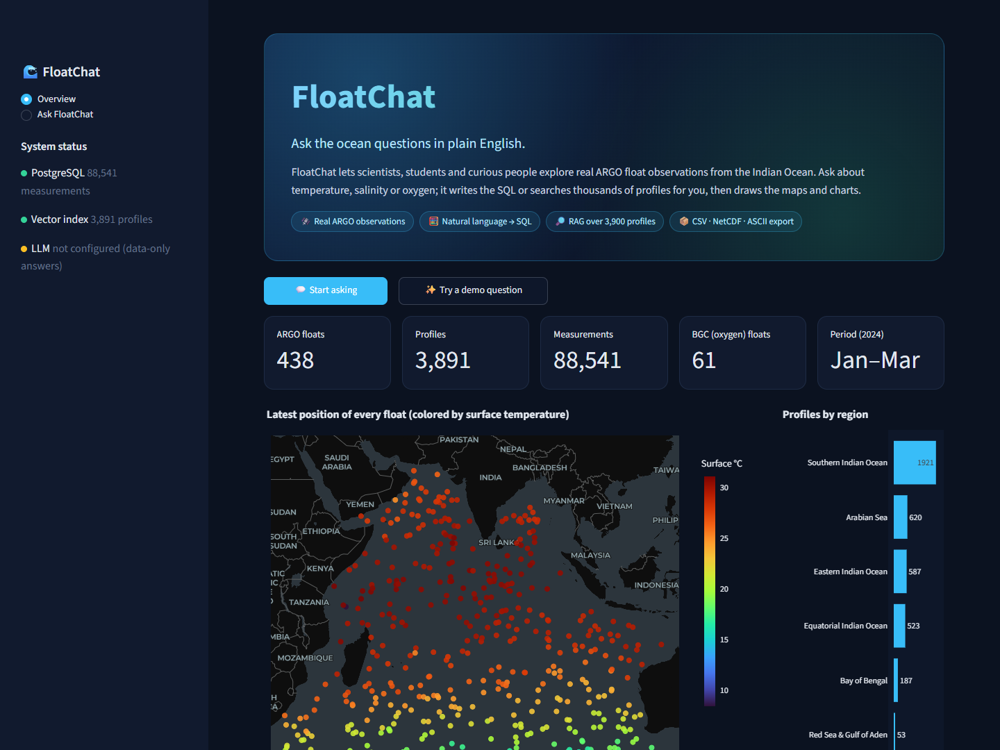
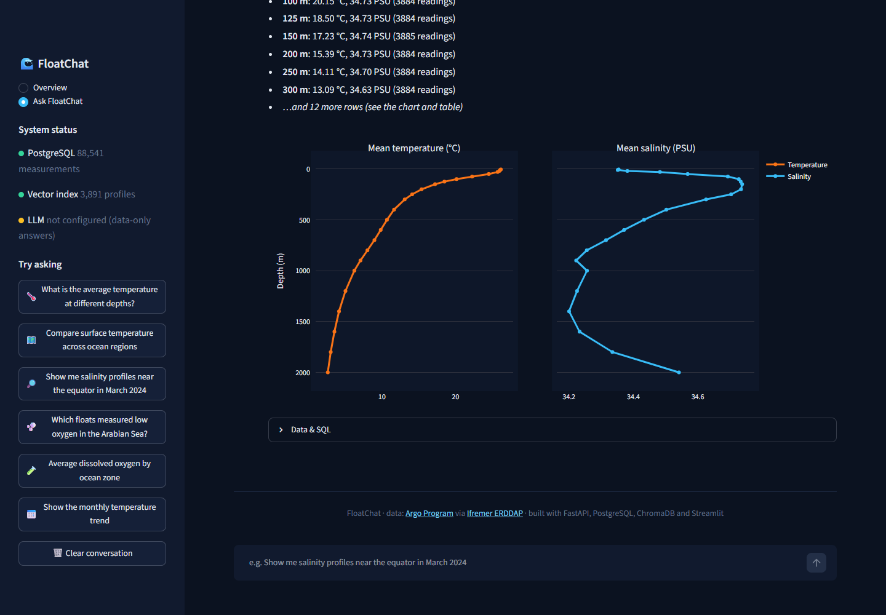
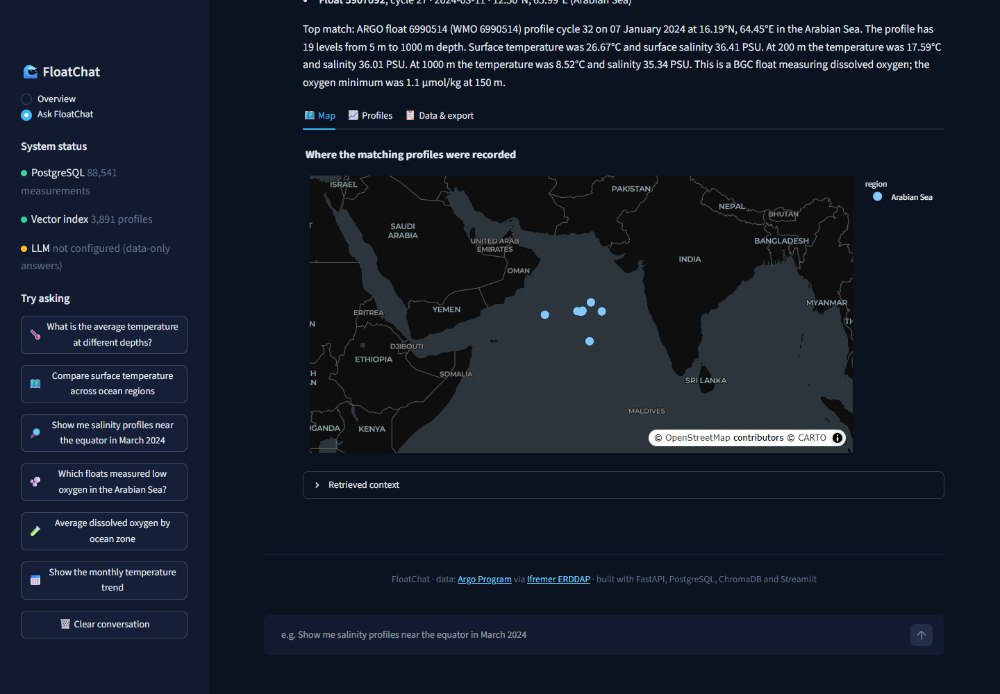

# 🌊 FloatChat: talk to the ocean

**FloatChat is an AI assistant for ARGO ocean float data.** Ask a question in plain English and it either
writes and runs SQL over PostgreSQL (for statistics) or searches a vector index of thousands of real float profiles
(for descriptive questions), then answers with maps, depth profiles and charts.



The bundled dataset is **real ARGO data**: 438 floats, 3,891 profiles and 88,500 measurements (61 of the floats also measure dissolved oxygen) from the Indian
Ocean (January–March 2024), downloaded from the [Ifremer ERDDAP](https://erddap.ifremer.fr/erddap/) server.

| Ask a statistical question → SQL + chart | Ask a descriptive question → RAG + map & profiles |
|---|---|
|  |  |

## ✨ What it does

- **Natural-language analytics.** "What is the average temperature at different depths?" becomes SQL. Common
  question types use vetted SQL templates; anything else is written by the LLM and checked to be a single read-only
  `SELECT` before it runs.
- **Semantic search over profiles (RAG).** Every profile is described in words (location, region, date, surface and
  deep temperature/salinity, oxygen minimum) and embedded in ChromaDB. Region and month names in your question
  ("near the equator in March") become metadata filters, and the LLM answers from the retrieved profiles.
- **Visuals for every answer:** float maps, temperature/salinity/oxygen depth profiles, regional and monthly charts.
- **Float explorer:** pick any float to see its trajectory and latest profiles.
- **Export** the profiles behind an answer as CSV, NetCDF or ASCII.
- **Works without an LLM.** With no LLM configured, SQL answers and profile search still work, and answers are
  built from the data. Add an LLM (Groq, Ollama, OpenAI, …) for written explanations.

## 🚀 Run it (Docker, recommended)

You need [Docker Desktop](https://www.docker.com/products/docker-desktop/) and git. Nothing else to download by
hand: the ARGO data ships in the repo (`data/argo_profiles.csv.gz`, 0.9 MB, plus 2.9 MB of precomputed
embeddings).

```bash
git clone https://github.com/CodexManvik/FloatChat-AI.git
cd FloatChat-AI
cp .env.example .env        # then paste your Groq API key into LLM_API_KEY (optional)
docker compose up --build
```

Open **http://localhost:8501** (the app) and http://localhost:8000/docs (the API).

The first run builds the Docker image (a few minutes, mostly downloading Python packages). After that the backend
loads the data into PostgreSQL and the vector index in about 30 seconds, using the precomputed embeddings in
`data/profile_embeddings.npz`. Later starts take seconds.

### Adding the LLM (Groq)

1. Create a free API key at https://console.groq.com/keys.
2. In `.env`, set:
   ```env
   LLM_BASE_URL=https://api.groq.com/openai/v1
   LLM_MODEL=llama-3.3-70b-versatile
   LLM_API_KEY=gsk_your_key_here
   ```
3. Restart: `docker compose up -d backend`. The sidebar shows a green **LLM** dot when it's connected.

Any OpenAI-compatible endpoint works the same way. See `.env.example` for Ollama, LM Studio and OpenAI settings.
If the model name above is retired, pick any chat model from the Groq console.

## 🛠️ Run it without Docker (for development)

Requires Python 3.11+ and a PostgreSQL database (`docker compose up -d db` starts one on port 5433).

```bash
python -m venv .venv
.venv\Scripts\activate          # macOS/Linux: source .venv/bin/activate
pip install -r requirements.txt
cp .env.example .env

python ingest.py                # load data into PostgreSQL + build the ChromaDB index
uvicorn main:app --port 8000    # API
streamlit run app.py            # frontend, in a second terminal
```

## 🏗️ How it works

```
                ┌──────────────────────────┐
  Streamlit  →  │  FastAPI  /query          │
  (app.py)      │   ├─ analytical? ──► NL→SQL (templates / LLM) ──► PostgreSQL
                │   └─ descriptive? ─► ChromaDB vector search (+ region/month filters)
                │                       └─► LLM answers from retrieved profiles
                └──────────────────────────┘
```

| File | Purpose |
|---|---|
| `app.py` | Streamlit frontend (overview, float explorer, chat) |
| `main.py` | FastAPI backend: `/query`, `/stats`, `/floats`, `/get_profiles`, `/export`, … |
| `nl_to_sql.py` | Question classification, SQL templates, LLM SQL generation and safety checks |
| `llm.py` | Minimal client for any OpenAI-compatible chat endpoint |
| `ingest.py` | Loads the seed data into PostgreSQL and builds the ChromaDB index |
| `ocean_regions.py` | Named Indian Ocean regions and question filter parsing |
| `export_utils.py` | CSV / NetCDF / ASCII exports |
| `scripts/fetch_argo_data.py` | Re-downloads ARGO data from ERDDAP (change dates/region with flags) |

**Database schema:** `floats` (one row per float) → `profiles` (one dive cycle: date, position, region) →
`measurements` (one depth level: pressure/depth, temperature, salinity, oxygen).

### Getting different data

```bash
python scripts/fetch_argo_data.py --start 2024-06-01 --end 2024-09-01 --bbox=-40,30,30,120
python ingest.py
```

`--bbox` is `lat_min,lat_max,lon_min,lon_max`. Re-ingesting new data re-embeds the changed profiles (a few
minutes on a CPU) and updates the embedding cache. Profiles are interpolated onto 24 standard pressure levels
(5–2000 dbar) to keep the dataset small. The named regions in `ocean_regions.py` cover the Indian Ocean; adjust
them if you fetch another basin.

## 💬 Questions to try

- What is the average temperature at different depths?
- Compare surface temperature across ocean regions
- Show me salinity profiles near the equator in March 2024
- Which floats measured low oxygen in the Arabian Sea?
- Average dissolved oxygen by ocean zone
- Show the monthly temperature trend
- Show a summary for each float

## 🗺️ Roadmap / known limitations

- The dataset is a 3-month Indian Ocean snapshot, not a live feed.
- Region boundaries are approximate boxes.
- Question routing (SQL vs. search) is keyword-based. An LLM router would handle more phrasings.
- `streamlit_app.py` + `components/` is an experimental, more feature-heavy dashboard that still partly uses
  mock data. It is not part of the demo (see `README_DASHBOARD.md`).
- Old one-off scripts live in `legacy/`.

**Demo tip:** links like `http://localhost:8501/?q=Average%20dissolved%20oxygen%20by%20ocean%20zone` open the chat
with that question already asked.

## 🙏 Acknowledgments

ARGO data were collected and made freely available by the International Argo Program and the national programs
that contribute to it ([argo.ucsd.edu](https://argo.ucsd.edu), [ocean-ops.org](https://www.ocean-ops.org)). The Argo
Program is part of the Global Ocean Observing System. Data accessed via the Ifremer ERDDAP server.
